# 🚀 076 Google Play Store Project

Day 76 of Udemy's *100 Days of Code: The Complete Python Pro Bootcamp*: clean a scraped Google Play Store data set and answer six market questions with Plotly charts. It is for course participants who want runnable, tested code and for anyone browsing for ideas.

## 📚 Table of Contents

- [Overview](#-overview)
- [Requirements](#-requirements)
- [Setup](#-setup)
- [Run](#-run)
- [Tests](#-tests)
- [License](#-license)
- [Links](#-links)
- [Appendix: Project documents](#-appendix-project-documents)

## 🧭 Overview

The project answers: how competitive each app category is, which category is popular, how many downloads a paid app gives up, how much to charge, which paid apps earn most, and whether paid apps recoup their development cost.

| Folder | What it holds |
| --- | --- |
| `src/play_store/` | The cleaning, exploration and chart functions, named as in the assignment |
| `tests/` | Tests that run on a small synthetic data set, not on the course file |
| `notebooks/` | The Jupyter notebook that follows the lecture step by step |
| `data/` | Where you put the course CSV (`apps.csv`); git ignores this folder |
| `docs/` | Project documents, screenshots (`docs/images/`) and the wiki sources (`docs/wiki/`: English, Danish, Bahasa Malaysia) |
| `scripts/` | `scan.sh` (opengrep) and `make_screenshots.py` |

The course data set is not part of this repository. Download it from the course lesson and save it as `data/apps.csv`.

### 🖼️ Lecture steps

One screenshot per lecture step, generated from the code with `python scripts/make_screenshots.py`. The [wiki][wiki] (English, Dansk, Bahasa Malaysia) explains what each step teaches.

**Step 1: Explore the data**

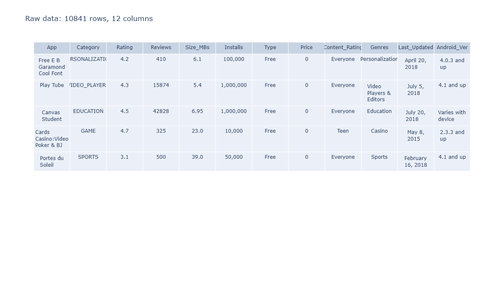

**Step 2: Rows after each cleaning stage**

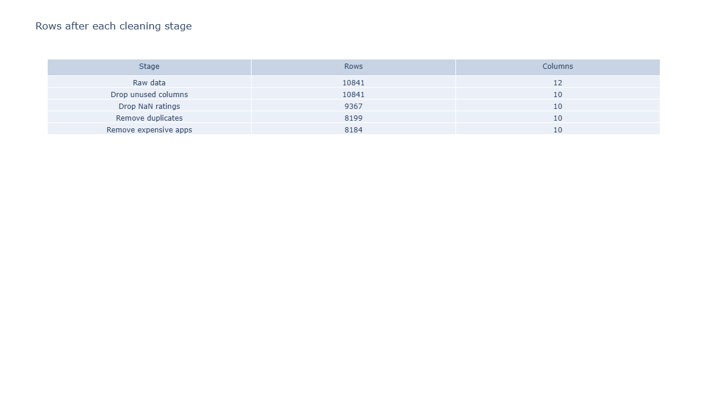

**Step 3: Highest rated apps**

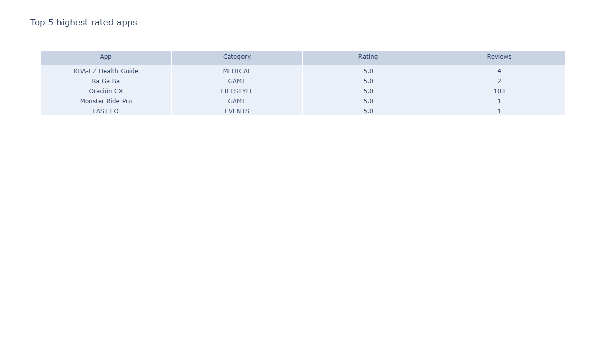

**Step 4: Largest apps**

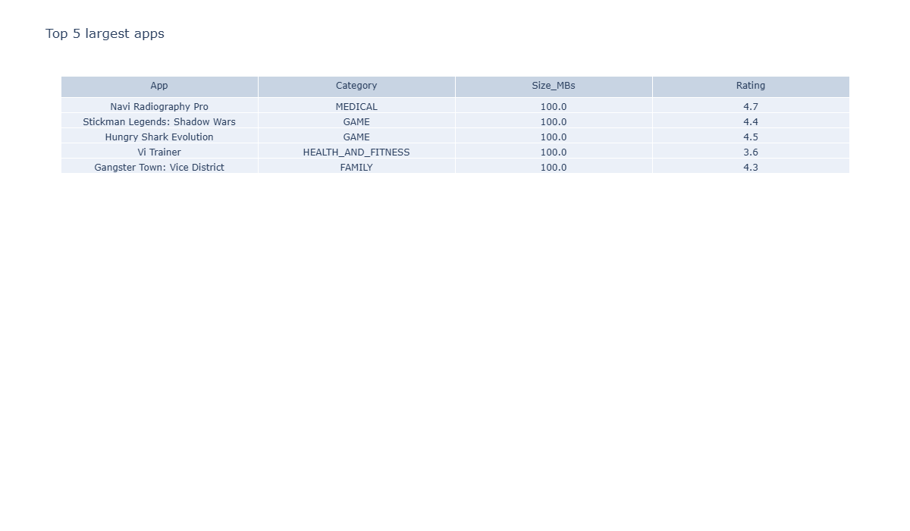

**Step 5: Most reviewed apps**

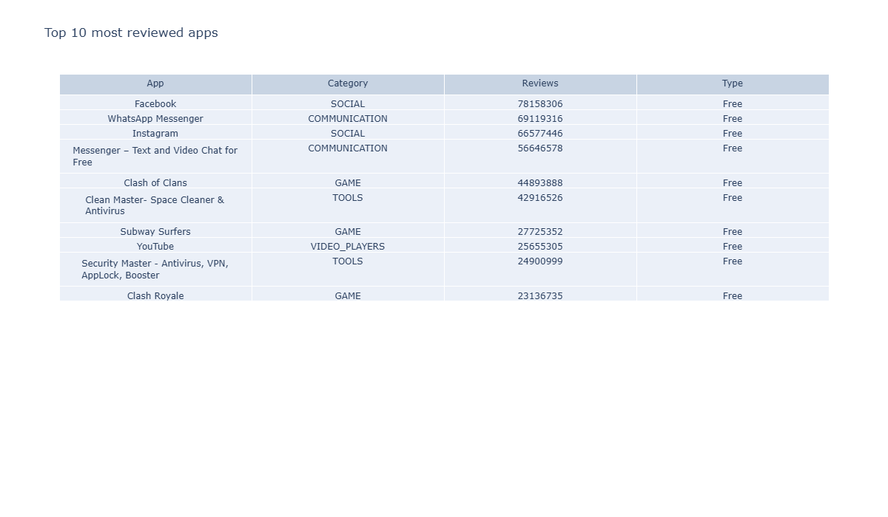

**Step 6: Content rating pie chart**

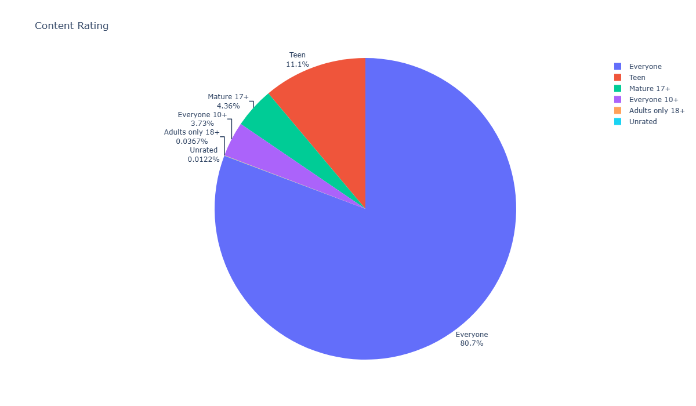

**Step 7: Content rating donut chart**

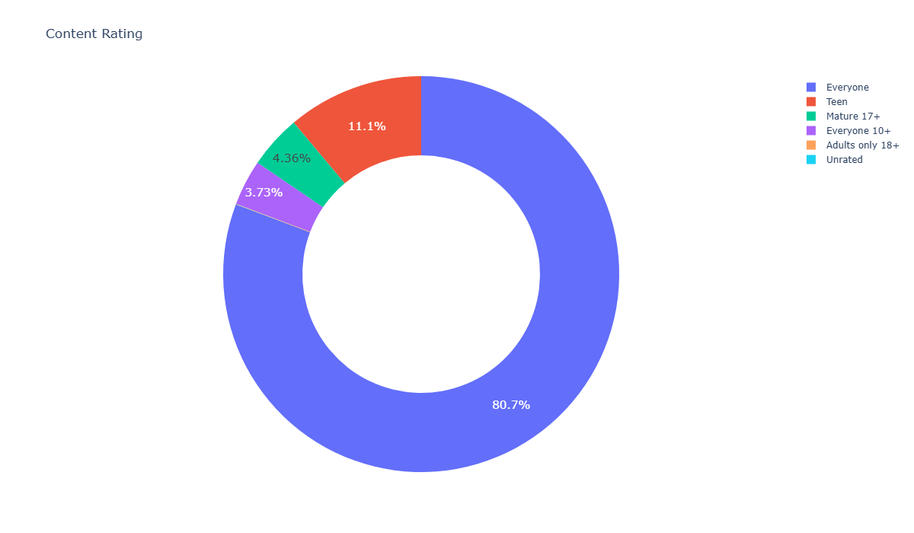

**Step 8: Top 10 categories by number of apps**

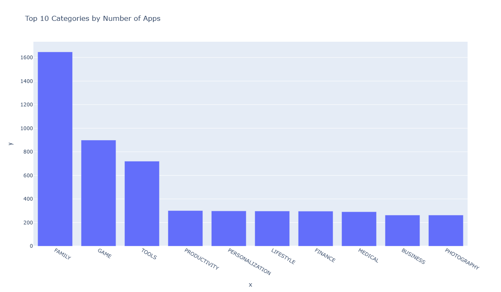

**Step 9: Category popularity**

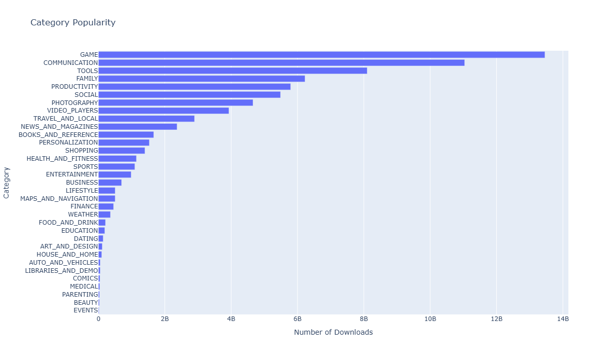

**Step 10: Category concentration**

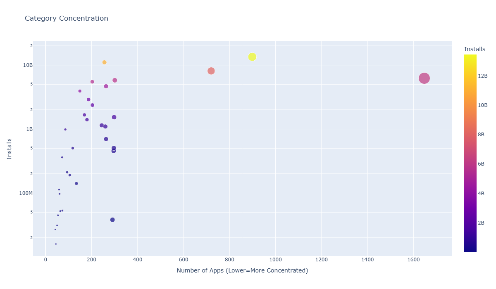

**Step 11: Top genres**

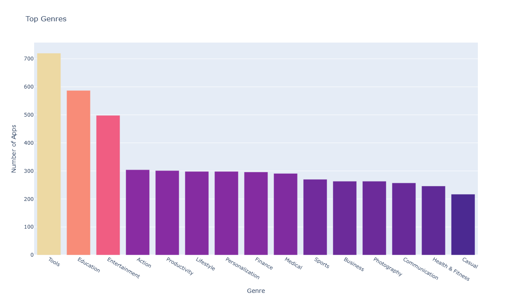

**Step 12: Free versus paid apps by category**

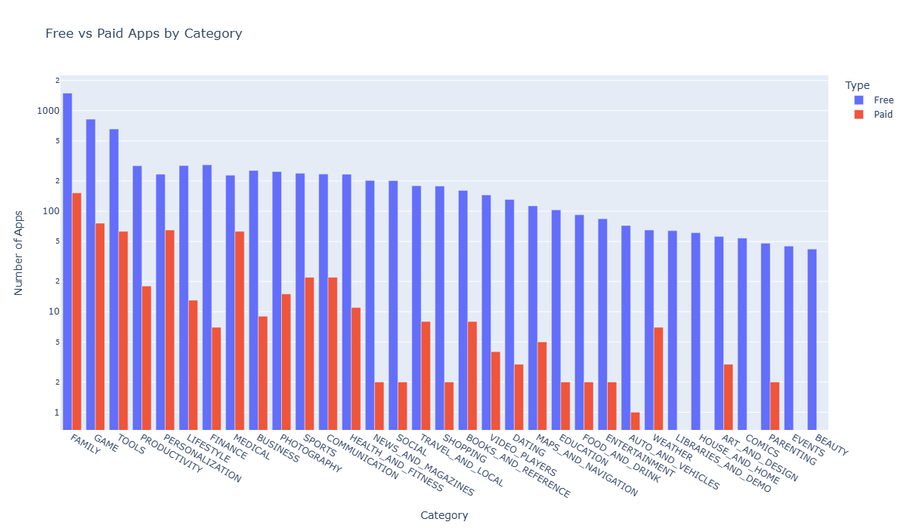

**Step 13: Installs of free versus paid apps**

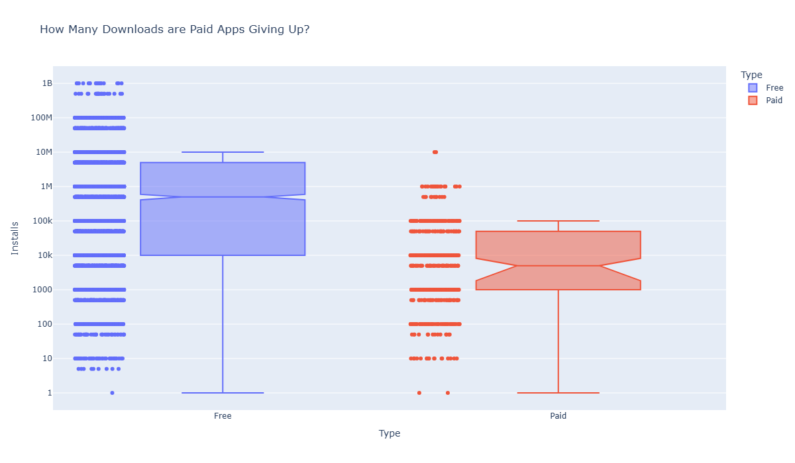

**Step 14: Highest-grossing paid apps**

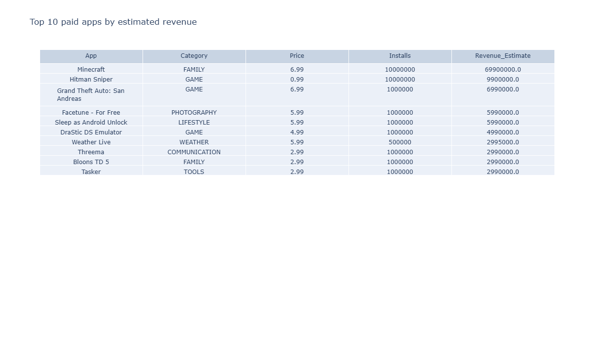

**Step 15: Paid app revenue by category**

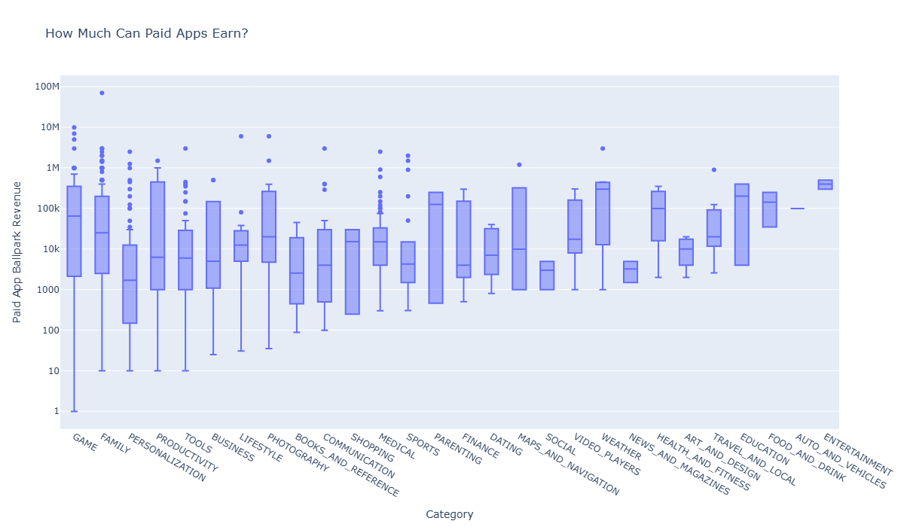

**Step 16: Paid app price by category**

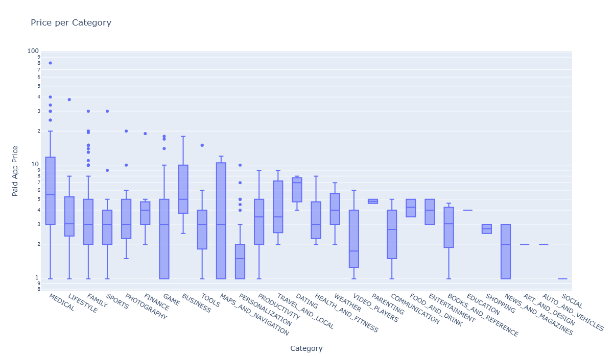

## 📋 Requirements

- Python 3.13 or newer.
- `pandas` and `plotly`, the only runtime dependencies; the setup below installs them.
- `pytest`, `pytest-cov` and `ruff`, only for development (the `dev` extra).
- Jupyter (the `notebook` extra) and `kaleido` (the `docs` extra) are optional.

## 🛠️ Setup

Create and use a local virtual environment named `.venv`.

Windows (PowerShell):

```powershell
python -m venv .venv
.venv\Scripts\Activate.ps1
python -m pip install --upgrade pip
python -m pip install -e ".[dev]"
```

Linux and macOS:

```bash
python3 -m venv .venv
source .venv/bin/activate
python -m pip install --upgrade pip
python -m pip install -e ".[dev]"
```

Add the notebook tools with `".[dev,notebook]"`, and chart image export with `".[dev,notebook,docs]"`. Leave out the extras to only run the analysis.

## ▶️ Run

Open the notebook (it reads `data/apps.csv`, or the path in the `PLAY_STORE_DATA` environment variable):

```bash
jupyter lab notebooks/google_play_store.ipynb
```

Regenerate the screenshots in `docs/images/` (needs the `docs` extra):

```bash
python scripts/make_screenshots.py
```

## 🧪 Tests

```bash
python -m pytest
```

Before pushing, scan the code with opengrep (default path `~/.opengrep/cli/latest/opengrep.exe`):

```bash
bash scripts/scan.sh
```

## 📄 License

GNU Affero General Public License v3.0, see [LICENSE][license].

## 🔗 Links

- [Repository][repository]
- [Documentation][documentation]
- [Issue tracker][issues]

## 📎 Appendix: Project documents

The documents a newcomer needs, in reading order.

| Document | What it tells you |
| --- | --- |
| [AGENTS.md][agents] | The rules AI agents follow in this repository |
| [Business Case][BC-001] | Why the project exists, its scope and success criteria |
| [Stakeholder Analysis][SA-001] | Who is involved; the stakeholder IDs used for owners and reviewers |
| [Project Plan][PP-001] | The gateways and their schedule |
| [Milestones][milestones] | One document per gateway: Go/No-Go criteria and tasks |
| [Artifact registry][registry] | Where each artifact type lives, the next version, the PO language and domain |
| [Traceability matrix][TM-001] | How the artifacts link and when each was last reviewed |
| [Framework README][framework-readme] | The framework this project uses |
| [Framework changelog][framework-changelog] | What changed in each framework release |

---

[wiki]: https://git.tirsystem.com/Tirsvad-Udemy-100-days-of-code/076-google-play-store-project/wiki
[license]: ./LICENSE
[repository]: https://git.tirsystem.com/Tirsvad-Udemy-100-days-of-code/076-google-play-store-project
[documentation]: https://git.tirsystem.com/Tirsvad-Udemy-100-days-of-code/076-google-play-store-project/wiki
[issues]: https://git.tirsystem.com/Tirsvad-Udemy-100-days-of-code/076-google-play-store-project/issues
[agents]: ./AGENTS.md
[BC-001]: ./docs/business-case.md
[SA-001]: ./docs/stakeholder-analysis.md
[PP-001]: ./docs/project-plan.md
[milestones]: ./docs/milestones/
[registry]: ./docs/artifact-registry.md
[TM-001]: ./docs/sqa/traceability-matrix.md
[framework-readme]: ./framework/README.md
[framework-changelog]: ./framework/CHANGELOG.md
