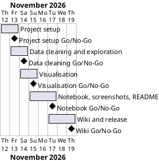

# Project Plan

## Metadata
| Key | Value |
| --- | --- |
| ID | PP-001 |
| CrossReference | [BC-001], [SA-001], [MIL-001], [MIL-002], [MIL-003], [MIL-004], [MIL-005] |
| Language | en |
| Domain | it |

## Version History
| Date | Status | Author | Reviewer | Change | Commit |
| --- | --- | --- | --- | --- | --- |
| 2026-11-12 | Accepted | Jens Tirsvad Nielsen | S01 (AI as stand-in) | Initial version; Go in RC-003 (autonomous, not independent) | pending |

---

## Purpose

This plan schedules the five gateways that deliver the Google Play Store Analysis project inside the one-week window set by the Business Case constraint (2026-11-12 to 2026-11-19).

## Planning Assumptions

- The plan starts 2026-11-12 and ends 2026-11-19, per the Business Case constraint ([BC-001]).
- One gateway per pull request; the AI works in autonomous mode after S01 accepts this plan ([SA-001], CR-001).
- The course CSV is supplied by S01 or downloaded with S01's permission before [MIL-004]; Business Case risk "signed link expires" applies.
- Gateways are decided by S01; in autonomous mode the AI is the recorded stand-in.

## Gateway Schedule

| Gateway | Document | Window | Decision date | Owner | Stories | Main deliverable | not yet synced |
| --- | --- | --- | --- | --- | --- | --- | --- |
| Project setup | [MIL-001] | 2026-11-12 to 2026-11-13 | 2026-11-13 | S01 | none (technical tasks) | Skeleton, README, .venv docs, opengrep, repository description and topics | not yet synced |
| Data cleaning and exploration | [MIL-002] | 2026-11-13 to 2026-11-14 | 2026-11-14 | S01 | none (technical tasks) | Tested cleaning and exploration functions | not yet synced |
| Visualisation | [MIL-003] | 2026-11-14 to 2026-11-15 | 2026-11-15 | S01 | none (technical tasks) | Tested Plotly chart builders | not yet synced |
| Notebook, screenshots, README | [MIL-004] | 2026-11-15 to 2026-11-17 | 2026-11-17 | S01 | none (technical tasks) | Jupyter notebook, screenshots, README | not yet synced |
| Wiki and release | [MIL-005] | 2026-11-17 to 2026-11-19 | 2026-11-19 | S01 | none (technical tasks) | Wiki in en, da, ms; release v1.0.0 | not yet synced |



## Scope Coverage

| Business Case scope item | Gateway |
| --- | --- |
| Python package under `src/`, tests, documents | [MIL-001], [MIL-002], [MIL-003] |
| `pyproject.toml`, `.venv` workflow, Python `.gitignore` | [MIL-001] |
| Jupyter notebook | [MIL-004] |
| Screenshots of every chart | [MIL-004] |
| README from the framework template | [MIL-001] (structure), [MIL-004] (screenshots) |
| Wiki in en, da and ms | [MIL-005] |
| Repository description and topics | [MIL-001] |
| opengrep before every push | [MIL-001] (script), every later gateway (use) |

## Dependencies

```
MIL-001 → MIL-002 → MIL-003 → MIL-004 → MIL-005
```

A No-Go on a gateway stops the later gateways. The gateway is reworked and re-reviewed; S01 decides whether the end date 2026-11-19 moves, and a move is recorded here as a new Version History row.

## Plan Risks

| Risk | Impact | Mitigation |
| --- | --- | --- |
| The course CSV is not available when [MIL-004] starts (Business Case risk: link expires) | Screenshots and notebook run cannot be produced | Code and tests of [MIL-002] and [MIL-003] use a synthetic fixture and do not wait; S01 is asked for the file; [MIL-004] and [MIL-005] wait |
| Translation takes longer than planned (Business Case risk: translation errors) | [MIL-005] slips | English first; Danish and Malay follow the same page set; S01 decides on a date move |
| Gitea API or token problem blocks description, wiki or release | Outward steps fail | The step stops and is reported; documents stay in the repository |

## Open Issues

- No governance document (GOV) exists; S01 is the sole accountable role and, in autonomous mode, the AI is the recorded stand-in for every review. Created only if a second stakeholder joins.
- The wiki is published to Gitea by pushing to the wiki repository; the publish workflow of git-workflows is not installed.

---

[BC-001]: ./business-case.md
[SA-001]: ./stakeholder-analysis.md
[MIL-001]: ./milestones/mil-001-project-setup.md
[MIL-002]: ./milestones/mil-002-data-cleaning-exploration.md
[MIL-003]: ./milestones/mil-003-visualisation.md
[MIL-004]: ./milestones/mil-004-notebook-readme-screenshots.md
[MIL-005]: ./milestones/mil-005-wiki-release.md
